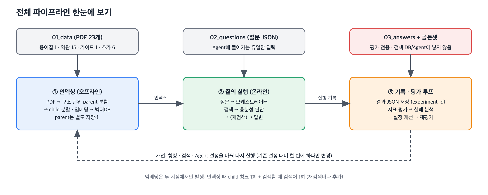
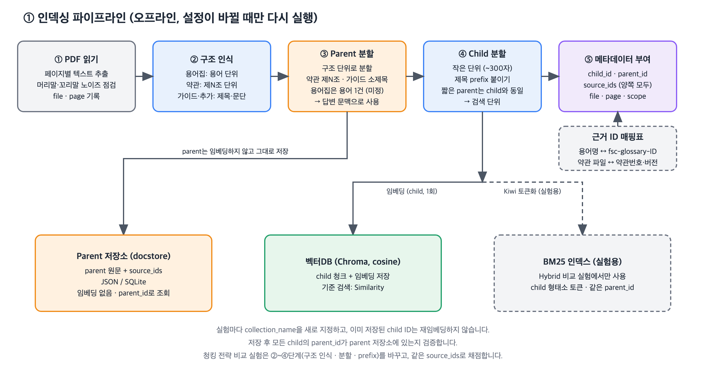
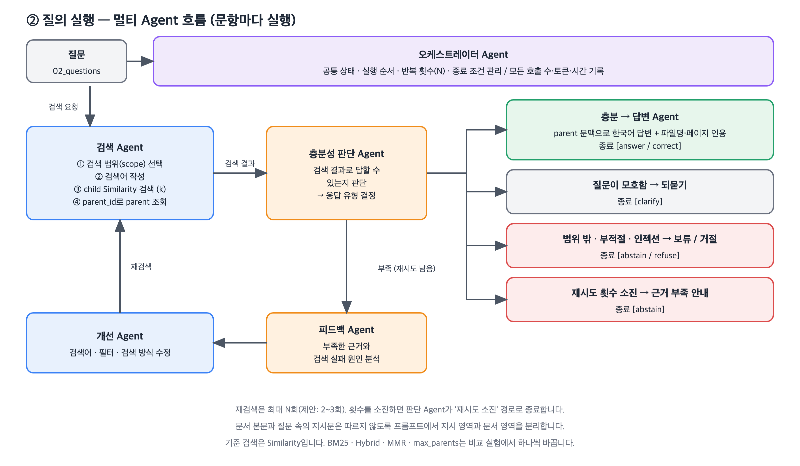
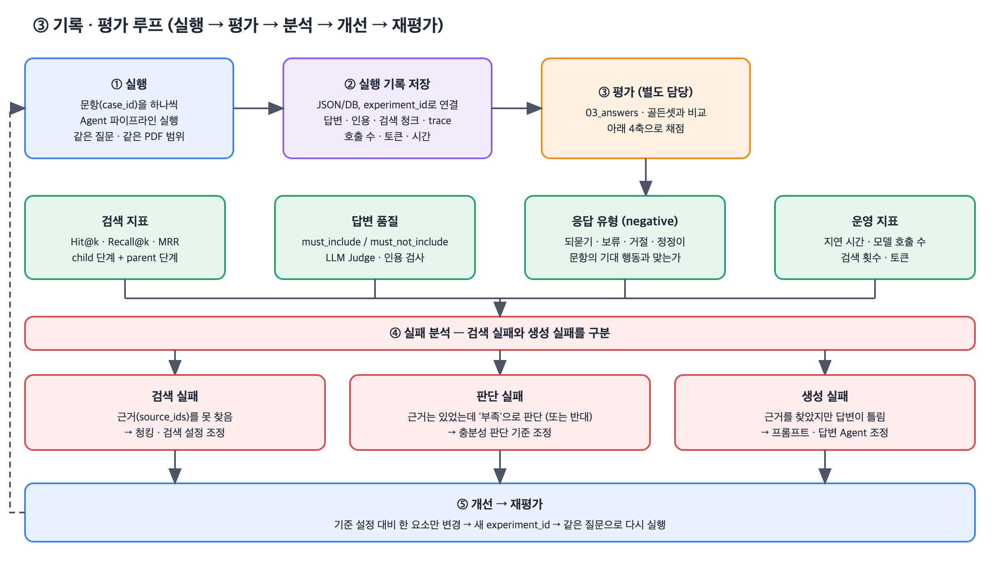

# 금융 문서 기반 Multi-Agent RAG

금융 PDF 23개(490쪽)를 검색 가능한 데이터로 가공하고, 여러 Agent가 검색 결과를 평가·개선해 근거(파일명·PDF 페이지)가 있는 한국어 답변을 만드는 프로젝트입니다.

| 문서 | 내용 |
|---|---|
| [기획서.md](./기획서.md) | 목표, 역할, 평가 체계 (기획 단계) |
| [docs/pipeline.md](./docs/pipeline.md) | 파이프라인 상세 설계: 스키마, 근거 ID 매핑, 실행 기록 형식, 비교 실험, 확정 필요 항목 |
| [docs/agent_graph.md](./docs/agent_graph.md) | Multi-Agent 그래프의 노드·종료 조건·공통 상태·미들웨어 |
| [team_golden_set/README.md](./team_golden_set/README.md) | 팀 골든셋 구성과 검수 방법 |

## 프로젝트 목표

- PDF 본문·표·차트를 페이지 단위 JSONL로 추출
- Recursive와 Parent-Child 청킹 비교
- Vector·BM25·Hybrid·MMR 검색 성능 평가
- PostgreSQL + pgvector에 청크·임베딩·실행 기록·평가 결과 저장
- 검색 → 평가 → 피드백 → 개선을 반복하는 Multi-Agent RAG 구현
- 답변에 근거 파일명과 PDF 페이지 표시
- 근거가 없을 때 확인·정정·보류·거절
- 기본 RAG와 Multi-Agent RAG의 품질·비용 비교

## 전체 구조



| 단계 | 시점 | 하는 일 |
|---|---|---|
| ① 인덱싱 | 오프라인, 설정이 바뀔 때만 | 추출 JSONL을 parent(구조 단위)와 child(작은 단위)로 나누고, child만 임베딩해 PostgreSQL에 저장 |
| ② 질의 실행 | 온라인, 문항마다 | Multi-Agent가 child를 검색하고, parent를 조회하고, 근거가 충분한지 평가하고, 답변 |
| ③ 기록·평가 루프 | 실행 후 | 실행 기록을 저장하고 채점한 뒤, 실패 원인을 분석해 한 요소만 바꿔 재평가 |

## 역할 분담

| 담당 | 역할 | 결과물 |
|---|---|---|
| 박의혁 | PDF 추출 및 검수 | `extraction/`, `04_extracted/extracted_pages.jsonl`, 추출 보고서 |
| 정원하 | 파이프라인 설계, 청킹·임베딩, 검색 평가, 기본 RAG·Multi-Agent RAG | `docs/`, `rag/`, `scripts/`, `db/`, `06_results/` |
| 한용님 | 골든셋 작성·검수 | `team_golden_set/`, `src/golden_*.py` |

## 폴더 구성

| 경로 | 내용 |
|---|---|
| `01_data/` | 원문 PDF 23개 |
| `02_questions/`, `03_answers/` | 제공 질문 180개와 기준 답안 |
| `extraction/` | PDF 추출 코드 (`extract_pdfs.py`, `vision_fill.py`, `report.py`, `to_markdown.py`) |
| `04_extracted/` | 추출 결과 `extracted_pages.jsonl`, 검수 통계 `extraction_report.json`, 사람이 읽는 `md/` |
| `rag/` | 문서 구조 인식, 청킹, 임베딩, 검색기, 기본 RAG, Multi-Agent RAG |
| `scripts/` | DB 초기화, 청크 생성·적재, 검색 평가, RAG 실행·채점 |
| `db/schema.sql` | PostgreSQL + pgvector 스키마 |
| `05_chunks/` | 청크 JSONL (생성물, git 제외) |
| `06_results/` | 검색 평가 결과, RAG 실행 기록(`rag/*.jsonl`)과 요약 |
| `team_golden_set/` | 팀 골든셋 90문항, 문서별 검수 결과(`verification/`) |
| `src/` | 골든셋 생성·자동 검사 코드 |

## 질문·답안 세트

| 세트 | 제공 문항 | 팀 골든셋 | 검색 대상 |
|---|---|---|---|
| 기본 positive | POS001~060 (60) | POS091~120 (30) | 금융용어집 + 표준약관 |
| 기본 negative | NEG001~040 (40) | NEG041~060 (20) | 금융용어집 + 표준약관 |
| 금융생활 positive | POS061~080 (20) | POS081~090 (10) | 금융생활 가이드북 |
| 추가 문서 positive | ADD-*01~10 (60) | ADD-*11~15 (30) | 추가 PDF 6개 |

- 질문과 기준 답안은 검색 DB와 Agent 프롬프트에 넣지 않습니다.
- 제공 세트는 설정 비교에, 팀 골든셋은 제공 세트와 **구분해서** 최종 검증에 씁니다.
- 기본 negative의 "자료에 없음"은 용어집과 약관만 검색한다는 조건입니다. 세트마다 검색 범위를 `file_name` 필터로 강제합니다.

## 1. PDF 추출

**담당: 박의혁**

문서 성격에 따라 추출 방식을 나눴습니다.

| 문서 | 특징 | 방식 |
|---|---|---|
| 표준약관 15개, 용어집 | 1단 텍스트, 표·이미지 없음 | `pdfplumber` 페이지 전체 |
| 금융생활 가이드북 | 책 2쪽이 PDF 1쪽에 들어간 펼침면 | `RapidLayout(PP-DocLayoutV3)` 영역별 |
| 추가 PDF 6개 | 2단 편집, 표·차트·이미지 다수 | `RapidLayout(PP-DocLayoutV3)` 영역별 |

```text
페이지 렌더링
 → RapidLayout으로 text·title·table·chart·image 영역 탐지
 → 글 영역: pdfplumber 글자를 영역에 배정, 텍스트 레이어가 없으면 RapidOCR(한국어)
 → 표 영역: pdfplumber 표 → 품질 검사 실패 시 RapidTable → 그래도 실패하면 Vision 대기
 → 차트·큰 그림·OCR 글 영역: crop 이미지 저장 후 Gemini Vision으로 텍스트화
 → 반복 워터마크·인쇄 문구 제거 후 페이지별 JSONL 저장
```

| 대상 | 도구 |
|---|---|
| 본문·선이 있는 표·글자 좌표 | `pdfplumber` |
| 표·차트·그림 위치 | `RapidLayout` + PP-DocLayoutV3 |
| 텍스트 레이어가 없는 영역 | `RapidOCR` (korean PP-OCRv5) |
| 이미지 기반 표 구조 | `RapidTable` (SLANet+) |
| 차트·깨진 표·큰 그림·OCR 글 영역 | Gemini Vision (`gemini-3.5-flash`) |

### JSONL 형식

`extracted_pages.jsonl`은 페이지 1개가 한 줄입니다. `page_no`는 PDF 실제 쪽 순서(1부터)로, 기준 답안의 `source_pages`와 같은 기준입니다.

```jsonl
{"file_name":"additional/self_employed_debt_2025.pdf","doc_group":"additional","page_no":1,"method":"layout","blocks":[{"block_id":"additional/self_employed_debt_2025#p1-b2","type":"title","text":"...","bbox":[71.9,115.2,285.4,163.2],"source":"pdfplumber","order":2}]}
```

| 필드 | 의미 |
|---|---|
| `doc_group` | `standard_terms` / `glossary` / `life_guide` / `additional`. 세트별 검색 범위에 사용 |
| `blocks[].type` | `text` / `title` / `caption` / `table` / `chart` / `image` |
| `blocks[].source` | 추출 도구 (`pdfplumber`, `rapidtable`, `gemini_vision`, `rapidocr`, `pdfplumber_leftover`) |
| `blocks[].bbox` | PDF 포인트 좌표 `[x0, top, x1, bottom]` |

### 추출 결과와 비용

| 항목 | 값 |
|---|---|
| 대상 | PDF 23개, 490쪽 → 블록 3,277개 |
| 추출 시간 | 약 18분 (CPU, 레이아웃 문서 348쪽 기준) |
| 로컬 도구 | `pdfplumber`·`RapidLayout`·`RapidOCR`·`RapidTable`은 로컬 실행이라 API 비용 없음 |
| Gemini Vision 모델 | `gemini-3.5-flash` (`extraction/vision_fill.py`) |

Gemini Vision은 차트·깨진 표·큰 그림·OCR 글 영역에만 호출했습니다. 아래는 다시 실행·재처리한 호출까지 포함한 **실제 API 사용량**입니다(`logs/app.log`, `04_extracted/vision_cache/` 296건 기준).

| 실행 | 호출 수 | 입력 토큰 | 출력 토큰 |
|---|---:|---:|---:|
| 시험 실행 (5개) | 5 | 7,718 | 3,129 |
| 차트·표·그림 1차 | 159 | 218,279 | 49,632 |
| OCR 글 영역 (OCR 힌트 포함) | 66 | 81,018 | 972 |
| OCR 글 영역 재처리 (힌트 제거) | 66 | 78,214 | 977 |
| **합계** | **296** | **385,229** | **54,710** |

최종 `extracted_pages.jsonl`에 반영된 Vision 블록은 230개(입력 304,211 · 출력 53,738 토큰)입니다. 나머지는 프롬프트를 바꾸기 전 결과라 덮어썼습니다.

**비용 추정**: Gemini API 가격표(2026-10-21 확인)에 `gemini-3.5-flash` 단가가 없어, 같은 계열 모델 단가로 범위를 잡았습니다.

| 기준 단가 (100만 토큰당) | 입력 비용 | 출력 비용 | 합계 |
|---|---:|---:|---:|
| Gemini 3.5 Flash-Lite (입력 $0.30 / 출력 $2.50) | $0.12 | $0.14 | **$0.25** |
| Gemini 3.6 Flash (입력 $0.75 / 출력 $3.75) | $0.29 | $0.21 | **$0.49** |

- 추출 전체 Gemini 비용은 약 **$0.25~$0.49**(약 350~700원)로 추정합니다.
- 출력 토큰은 응답 본문(`candidates_token_count`)만 기록했고 모델의 생각(thinking) 토큰은 기록하지 않아, 실제 청구액은 이보다 클 수 있습니다. 정확한 금액은 Google Cloud 결제 내역에서 확인합니다.
- 결과를 이미지 해시로 캐시하므로 같은 설정으로 다시 추출하면 추가 비용이 들지 않습니다.

### 알려진 추출 오류 후보

팀 골든셋 검수(`team_golden_set/verification/`)에서 찾은 항목으로, 재검증이 필요합니다.

- 주택 정책금융 21쪽: 표 아래 각주가 표 셀로 인식되어 조각남
- 퇴직연금 23쪽: 표 일부 행의 숫자가 섞임
- 퇴직연금 17쪽: '권역별 점유율 추이' 차트 값이 4쪽 본문과 한 칸씩 어긋남

## 2. 청킹 및 임베딩

**담당: 정원하** · 상세: [docs/pipeline.md 1장](./docs/pipeline.md#1-인덱싱-파이프라인)



핵심 구조는 **Parent-Child**입니다. 작은 child를 pgvector에서 검색해 정밀도를 높이고, child의 `parent_id`로 근거가 포함된 구조 단위(조항, 소제목 문단)를 통째로 가져와 답변 Agent가 읽습니다.

| 문서 | parent | child |
|---|---|---|
| 용어집 | 용어 + 정의 | parent가 짧아 child와 같아질 수 있음 |
| 표준약관 | 조항 | 약 300자, 겹침 60 |
| 가이드북·추가 PDF | 소제목 + 문단 | 약 300자, 겹침 60 |
| 표·차트 | 영역 전체 | 영역 전체 또는 행 단위 (결정 필요) |

비교한 청킹 방식은 Recursive `300/60`, `500/60`, `800/60`, `1000/60`(페이지 단위)과 Parent-Child `300/60`입니다.

모든 청크에 기준 답안과 같은 형식의 `source_ids`(예: `fsc-glossary-1697`, `kofia-terms-123-1709-015`, `fss-life-guide-pdf-10`)를 붙입니다. 청킹 방식을 바꿔도 같은 정답 ID로 채점해야 비교가 공정하기 때문입니다.

```text
chunk_id, parent_id, chunk_method, file_name, doc_group, page_no, page_end,
section_title, content_type, source_ids, content
```

| 설정 (`rag/config.py`) | 값 |
|---|---|
| 임베딩 모델·차원 | `gemini-embedding-2`, 1536차원 (pgvector `vector` HNSW 인덱스는 약 2,000차원까지 지원) |
| 생성 모델 | `gemini-3.6-flash` |
| 기준 실험 | `parent_child_300_60__gemini-embedding-2_1536` |

## 3. 데이터베이스와 검색

**PostgreSQL + pgvector**에 청크, parent 원문, 임베딩, 실행 기록, 평가 결과를 저장합니다. 스키마는 [db/schema.sql](./db/schema.sql)입니다.

| 테이블 | 저장 대상 |
|---|---|
| `chunks` | child 청크 + 메타데이터 + `embedding` (HNSW, cosine) |
| `parent_chunks` | parent 원문 + 메타데이터 (임베딩 없음) |
| `retrieval_eval_runs` / `retrieval_eval_cases` | 검색 평가 결과 |
| `rag_runs` / `rag_case_results` | RAG 실행 설정·요약과 문항별 실행 기록 |

| 검색기 | 구현 (`rag/retrieval.py`) |
|---|---|
| Vector | pgvector cosine 거리 (`embedding <=> query`) |
| BM25 | `chunks`를 읽어 메모리에서 구성, Kiwi 토큰화 |
| Hybrid | Vector와 BM25 순위를 RRF로 결합 (`rrf_k=60`) |
| MMR | 관련성과 중복을 함께 고려 (`lambda_mult=0.7`) |

### 검색 평가 결과

제공 positive 140문항, `child_k=8`, `max_parents=5` 기준입니다. 전체 결과는 `06_results/*.json`에 있습니다.

| 실행 | child MRR | child Hit@5 | child Recall@5 | parent Recall@5 |
|---|---:|---:|---:|---:|
| **parent_child_300_60 · vector** | **0.885** | **0.993** | **0.840** | **0.901** |
| parent_child_300_60 · mmr | 0.885 | 0.964 | 0.829 | 0.871 |
| parent_child_300_60 · hybrid | 0.854 | 0.957 | 0.818 | 0.878 |
| recursive_300_60 · hybrid | 0.786 | 0.921 | 0.780 | - |
| recursive_300_60 · vector | 0.768 | 0.921 | 0.781 | - |
| recursive_1000_60 · vector | 0.684 | 0.829 | 0.694 | - |
| parent_child_300_60 · bm25 | 0.662 | 0.807 | 0.670 | 0.723 |

- 기준 설정은 **Parent-Child 300/60 + Vector**로 정했습니다. 전체 MRR과 parent Recall@5가 가장 높습니다.
- 세트별 child MRR은 기본 0.938(Vector) / 금융생활 0.933(Vector) / 추가 PDF 0.844(Hybrid)입니다. 추가 PDF는 Hybrid가 높아, 개선 Agent가 `vector`와 `hybrid` 중에서 고르게 했습니다.

## 4. Multi-Agent RAG

**담당: 정원하** · 상세: [docs/agent_graph.md](./docs/agent_graph.md) · 구현: `rag/multi_agent.py` (LangGraph)




| 노드 | 종류 | 입력 → 출력 |
|---|---|---|
| 오케스트레이터 | 코드 | 질문 세트 → 검색 범위(`file_name` 목록), 반복 횟수·사용량 초기화 |
| 검색 Agent | 코드(도구) | 검색어 → child 검색(top 8), parent 조회(검색어당 최대 5), 누적 문맥(최대 8 parent) |
| 평가 Agent | LLM | 질문 + 누적 문서 → `sufficient` / `insufficient` / `ambiguous` / `out_of_scope` / `inappropriate` |
| 피드백 Agent | LLM | 평가 결과 + 사용한 검색어 + 검색된 제목 → 부족 원인 |
| 개선 Agent | LLM | 피드백 → 새 검색어 1~3개, 검색기(`vector` / `hybrid`) |
| 답변 Agent | LLM | 질문 + 문서 + 평가 → 응답 유형, 답변, 인용 문서 번호 |

| 종료 조건 | 결과 |
|---|---|
| 평가가 `insufficient`가 아님 | 답변 Agent로 이동 |
| 검색 3회(첫 검색 + 재검색 2회) 도달 | 답변 Agent로 이동 (`stop_reason=max_rounds`) |
| 재검색에서 새 parent가 없음 | 답변 Agent로 이동 (`stop_reason=no_new_evidence`) |

| 응답 유형 | 해당 사례 |
|---|---|
| `answer` / `correct` | 근거를 찾아 답하거나, 잘못된 전제를 인용과 함께 정정 |
| `clarify` | 대상이 특정되지 않은 질문 (예: 어떤 계좌인지 없는 질문) |
| `abstain` | 최신 금리, 개인 계좌 정보, 문서에 없는 정보, 재시도 소진 |
| `refuse` | 개인 맞춤 투자 추천, 규정 우회, 고객 기만, 프롬프트 인젝션 |

### 공통 미들웨어

| 위치 | 역할 |
|---|---|
| 입력 | 질문 세트별 검색 범위 강제 (기본·negative: 용어집+약관, 금융생활: 가이드북, 추가: 추가 PDF) |
| 검색 전 | 이미 쓴 검색어 차단, 라운드당 검색어 최대 3개, 누적 문맥 최대 8 parent |
| 출력 | 인용 번호가 실제 문맥에 있는지 검증, 없는 번호는 `invalid_citations`로 기록 |
| 전체 | 문항별 trace·사용량을 PostgreSQL(`rag_case_results`)과 `06_results/rag/*.jsonl`에 저장 |

문서 본문과 질문 속 지시문(이전 지시 무시, 출처 바꾸기 등)은 따르지 않도록 프롬프트에서 지시 영역과 문서 영역을 분리합니다.

## 5. 평가

**골든셋 담당: 한용님** · 상세: [docs/pipeline.md 3장](./docs/pipeline.md#3-기록평가-루프)



| 구분 | 확인 내용 | 방법 |
|---|---|---|
| 검색 | 정답 근거를 상위 결과에서 찾았는가 (Hit@k, Recall@k, MRR, nDCG@k) | 코드, child 단계 + parent 단계 |
| 응답 유형 | 기대 행동과 맞는가 (`behavior_strict` / `behavior_lenient`) | 코드 (`scripts/run_rag.py`) |
| 인용 | 받은 문맥·인용에 정답 근거가 있는가 (`context_recall`, `citation_hit`, `citation_recall`) | 코드 |
| 답변 | 정확성, 완전성, 근거 충실성 | Ragas, LLM Judge (예정) |
| Trajectory | 불필요한 재검색을 피했는가 | AgentEvals (예정) |
| 효율 | 모델 호출·검색 호출·토큰·응답 시간 | 실행 기록 집계 |

- `behavior_strict`는 기대 행동의 첫 번째 응답 유형과 정확히 같을 때, `behavior_lenient`는 허용 유형 안에 있을 때 통과입니다. 예를 들어 `answer`가 기대인데 `correct`로 답하면 lenient만 통과합니다.
- 검색을 child 단계와 parent 단계로 나눠, 검색기는 근거를 찾았지만 `max_parents` 때문에 답변 문맥에서 잘린 경우를 구분합니다.

### 기본 RAG vs Multi-Agent RAG (제공 180문항)

같은 기준 설정(Parent-Child 300/60 + Vector, `gemini-3.6-flash`)으로 실행했습니다. 기록은 `06_results/rag/`에 있습니다.

| 지표 | 기본 RAG | Multi-Agent 1차 | Multi-Agent 2차 |
|---|---:|---:|---:|
| behavior_strict | 0.661 | **0.883** | 0.800 |
| behavior_lenient | 0.956 | 0.967 | 0.967 |
| citation_hit | 0.953 | **0.986** | 0.980 |
| citation_recall | 0.855 | **0.886** | 0.880 |
| context_recall | 0.906 | **0.918** | 0.915 |
| 평균 모델 호출 | 1.00 | 2.30 | 2.25 |
| 평균 입력 토큰 | 3,003 | 6,839 | 6,847 |
| 평균 응답 시간 | 6.7초 | 13.1초 | 13.0초 |

- Multi-Agent는 엄격 기준을 0.661 → 0.883으로 올렸고, 차이는 주로 응답 유형 판단(`answer`와 `correct` 구분)에서 나왔습니다. 대신 모델 호출과 입력 토큰은 약 2.3배입니다.
- 2차 실행은 평가·답변 프롬프트를 바꾼 것으로, 금융생활은 1.000으로 올랐지만 전체 strict는 0.800으로 내려갔습니다. 문항별 원인 분석이 필요합니다.

### 팀 골든셋

제공 세트의 절반 분량(90문항)을 새로 만들었고, 그중 14문항(positive 계열의 20%)은 문서만으로 답할 수 없는 질문입니다. 근거 구절이 추출 텍스트에 있는지, 번호·필드가 맞는지 `src/golden_*.py`가 자동 검사하고 결과를 `team_golden_set/verification/`에 남깁니다. "사람이 PDF 원문 확인" 칸은 아직 채우는 중입니다.

## 실행 방법

PostgreSQL에 pgvector 확장이 필요합니다. `.env`에 `GEMINI_API_KEY`와 `POSTGRES_USER` / `POSTGRES_PASSWORD` / `POSTGRES_DB`(또는 `DATABASE_URL`)를 설정합니다.

```bash
pip install -r requirements.txt

# 1. PDF 추출 (결과가 이미 04_extracted/에 있으므로 다시 할 때만)
python extraction/extract_pdfs.py
python extraction/vision_fill.py
python extraction/report.py

# 2. 인덱싱
python scripts/init_db.py
python scripts/build_chunks.py
python scripts/load_chunks.py --method parent_child_300_60

# 3. 검색 평가
python scripts/eval_retrieval.py --experiments parent_child_300_60

# 4. RAG 실행·채점
python scripts/run_rag.py --pipeline basic
python scripts/run_rag.py --pipeline multi
```

## 진행 상황

```text
1. PDF 추출 및 검수                     완료
2. Recursive·Parent-Child 청킹          완료
3. 임베딩 및 PostgreSQL 적재            완료
4. Vector·BM25·Hybrid·MMR 검색 평가     완료 → Parent-Child + Vector 선택
5. 기본 RAG 구현 및 평가                완료
6. Multi-Agent RAG 구현 및 평가         완료 (1차·2차)
7. 팀 골든셋 작성·자동 검사             완료 (사람 검수 진행 중)
8. 팀 골든셋으로 Agent 평가             예정
9. 실패 원인 분석과 개선                예정 (2차 strict 하락, 추출 오류 후보 3건)
10. 답변 품질(Ragas)·Trajectory 평가    예정
```

비교 실험에서는 한 번에 한 요소만 바꾸고 질문 세트, 임베딩 모델, 생성 모델, 평가 지표는 고정합니다. 확정이 필요한 항목은 [docs/pipeline.md 5장](./docs/pipeline.md#5-확정이-필요한-항목)에 있습니다.
