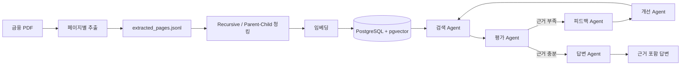

# 금융 문서 기반 Multi-Agent RAG

금융 PDF를 검색 가능한 데이터로 가공하고, 여러 Agent가 검색 결과를 평가·개선하여 근거 있는 한국어 답변을 생성하는 프로젝트입니다.

> 상세 기획: [기획서.md](./기획서.md)

## 프로젝트 목표

- PDF 본문·표·차트를 페이지 단위 JSONL로 추출
- Recursive 및 Parent-Child 청킹 비교
- Vector·BM25·Hybrid·MMR 검색 성능 평가
- PostgreSQL과 pgvector에 청크·임베딩·실험 결과 저장
- Multi-Agent 검색 개선 루프 구현
- 답변에 근거 파일명과 PDF 페이지 표시
- 근거가 없을 때 확인·정정·보류·거절

## 전체 구조



## 역할 분담

| 담당 | 역할 | 결과물 |
|---|---|---|
| 박의혁 | 전체 PDF 추출 및 검수 | `extracted_pages.jsonl`, 추출 코드·보고서 |
| 정원하 | 청킹·임베딩, 검색 평가, Multi-Agent RAG 구현 | 청크·임베딩, Agent 코드, 평가 결과 |
| 한용님 | 골든셋 QA | 검수된 질문·기준 답변·근거 파일·페이지 |

## 제공 데이터

| 폴더 | 내용 | 용도 |
|---|---|---|
| `01_data/` | 원문 PDF 23개 | 추출·청킹·검색 대상 |
| `02_questions/` | 질문 JSON 180개 | RAG 및 Agent 입력 |
| `03_answers/` | 기준 답안 MD·JSONL 180개 | 평가 기준 |

### 원문 PDF 구성

| 경로 | 개수 | 내용 |
|---|---:|---|
| `financial_glossary_readable.pdf` | 1 | 금융용어 정의 |
| `standard_terms/` | 15 | 증권·신용·연금·전자금융 등 표준약관 |
| `financial_life_guide.pdf` | 1 | 재무관리·저축·투자 가이드 |
| `additional/` | 6 | 주택연금·퇴직연금·정책금융·보험 등 |

### 질문·답안 세트

| 세트 | 문항 | 검색 대상 |
|---|---:|---|
| 기본 positive | POS001~POS060, 60개 | 금융용어집 + 표준약관 |
| 기본 negative | NEG001~NEG040, 40개 | 금융용어집 + 표준약관 |
| 금융생활 positive | POS061~POS080, 20개 | 금융생활 가이드북 |
| 추가 문서 positive | ADD-*, 60개 | 추가 PDF 6개 |

질문과 기준 답안은 검색 DB에 넣지 않습니다. 제공 평가 세트는 전체 성능 비교에 사용하고, 직접 작성·검수한 `golden_cases.jsonl`은 최종 검증에 사용합니다.

## 1. PDF 추출

**담당: 박의혁**

| 대상 | 도구 |
|---|---|
| 일반 본문·선이 있는 표 | `pdfplumber` |
| 스캔 이미지 글자 | `RapidOCR` |
| 표·차트·그림 위치 | `RapidLayout + PP-DocLayoutV3` |
| 이미지 표 구조 | `RapidTable` |
| 복잡한 표·차트·다이어그램 | Gemini Vision |

기본 추출은 `pdfplumber`로 처리하고, 실패하거나 구조가 깨진 페이지만 OCR·RapidTable·Gemini Vision으로 보완합니다.

```text
PDF
 → pdfplumber 본문·일반 표 추출
 → 실패 페이지 OCR
 → 복잡한 영역 탐지·해석
 → 페이지별 JSONL 저장
```

### JSONL 형식

- `extracted_pages.jsonl`: 페이지 1개가 한 줄
- `chunks.jsonl`: 청크 1개가 한 줄
- Agent 실행 기록: PostgreSQL 저장 후 필요할 때 JSONL로 내보내기

```jsonl
{"file_name":"guide.pdf","page_no":1,"blocks":[{"type":"text","text":"본문...","bbox":[80,100,520,700]}]}
```

## 2. 청킹 및 임베딩

**담당: 정원하**

다음 방식만 생성하고 비교합니다.

| 방법 | 설정 |
|---|---|
| Recursive | `300/60`, `500/60`, `800/60`, `1000/60` |
| Parent-Child | 작은 Child로 검색하고 큰 Parent를 답변 문맥으로 사용 |

Parent 단위는 문서 구조에 맞게 구성합니다.

| 문서 유형 | Parent 단위 |
|---|---|
| 금융용어집 | 용어 + 정의 |
| 표준약관 | 조항 |
| 가이드북·보고서 | 소제목 + 문단 |
| 표·차트 | 전체 영역과 단위·각주 |

모든 청크에 다음 메타데이터를 저장합니다.

```text
chunk_id, parent_id, file_name, page_no,
section_title, content_type, chunk_method, experiment_id
```

임베딩 모델과 차원은 모든 비교 실험에서 동일하게 고정합니다.

## 3. 데이터베이스와 검색

데이터베이스는 **PostgreSQL + pgvector**를 사용합니다.

- 청크 원문·Parent 문맥·메타데이터
- 임베딩 벡터
- 질문과 실험 설정
- 검색 및 Agent 실행 기록
- 문항별 평가 결과

각 청킹 설정에 다음 검색기를 모두 적용합니다.

| 검색기 | 특징 |
|---|---|
| Vector | 의미 유사도 검색 |
| BM25 | 정확한 금융용어 중심 검색 |
| Hybrid | Vector와 BM25 결과 결합 |
| MMR | 관련성을 유지하면서 중복 감소 |

## 4. Multi-Agent RAG

**담당: 정원하**

| Agent | 역할 |
|---|---|
| 오케스트레이터 Agent | 공통 상태, 실행 순서, 반복 횟수와 종료 조건 관리 |
| 검색 Agent | 검색 범위·검색어·검색기를 선택하고 근거 검색 |
| 평가 Agent | 검색 결과가 답변하기 충분한지 판단 |
| 피드백 Agent | 부족한 근거와 검색 실패 원인 분석 |
| 개선 Agent | 검색어·필터·검색 방식을 수정 |
| 답변 Agent | Parent 문맥으로 답변하고 파일명·페이지 인용 |

```text
질문
 → 오케스트레이터
 → 검색
 → 검색 결과 평가
    ├─ 충분함 → 답변 → 종료
    └─ 부족함 → 피드백 → 개선 → 재검색
```

재검색은 최대 2~3회로 제한하고 같은 검색 결과가 반복되면 종료합니다.

### 공통 미들웨어

- 질문 세트에 맞는 검색 문서 범위 강제
- 도구 인자 검증과 일시 오류 재시도
- 중복 검색과 최대 호출 횟수 제한
- 답변의 파일명·페이지가 실제 검색 결과에 있는지 검증
- `logs/app.log`와 PostgreSQL에 실행 과정 기록

## 5. 평가

**골든셋 QA 담당: 한용님**

### 검색 평가

- `Hit@k`
- `Recall@k`
- `MRR`
- `nDCG@k`

### RAG Agent Evaluation

| 구분 | 평가 내용 |
|---|---|
| 답변 | 정확성·완전성·근거 충실성·인용 정확성 |
| Negative | 근거 없는 답변과 잘못된 보류 여부 |
| Tool-use | 도구·검색 범위·인자 선택 |
| Agent Trajectory | 필요한 단계 수행과 불필요한 재검색 여부 |
| 효율 | 호출 횟수·응답 시간·토큰·비용 |

평가 도구는 다음 조합을 기본으로 사용합니다.

- 커스텀 코드: 검색 지표·인용·호출 횟수
- Ragas: 검색 문맥과 최종 답변
- AgentEvals: Agent 실행 경로

골든셋은 질문, 기준 답변, 근거 구절, 파일명, 페이지, 필수·금지 내용을 PDF 원문과 대조해 검수합니다.

## 6. 진행 순서

```text
1. PDF 추출 및 검수
2. 추출 JSONL 공유
3. Recursive·Parent-Child 청킹
4. 임베딩 및 PostgreSQL 적재
5. Vector·BM25·Hybrid·MMR 검색 평가
6. 최적 청킹·검색기 선택
7. 기본 RAG 구현 및 평가
8. Multi-Agent RAG 구현 및 평가
9. 실패 원인 분석과 개선
10. 골든셋 최종 검증
```

비교 실험에서는 한 번에 한 요소만 변경하고 질문 세트, 임베딩 모델, 생성 모델과 평가 지표는 동일하게 유지합니다.

## 결과 기록

각 실험은 `experiment_id`로 설정과 결과를 연결합니다.

- 모델·프롬프트 버전
- 청킹·검색 설정
- 검색어와 검색 청크 ID
- 답변과 인용
- Agent 단계별 실행 기록
- 응답 시간·토큰·비용
- 평가 점수와 실패 원인

## 제출 결과물

- PDF 추출 코드·JSONL·검수 보고서
- 청킹·임베딩·검색 코드
- PostgreSQL + pgvector 구성
- Multi-Agent 그래프와 실행 코드
- 검수된 골든셋
- 검색·답변·Agent 평가 결과
- 실패 사례와 개선 내역
